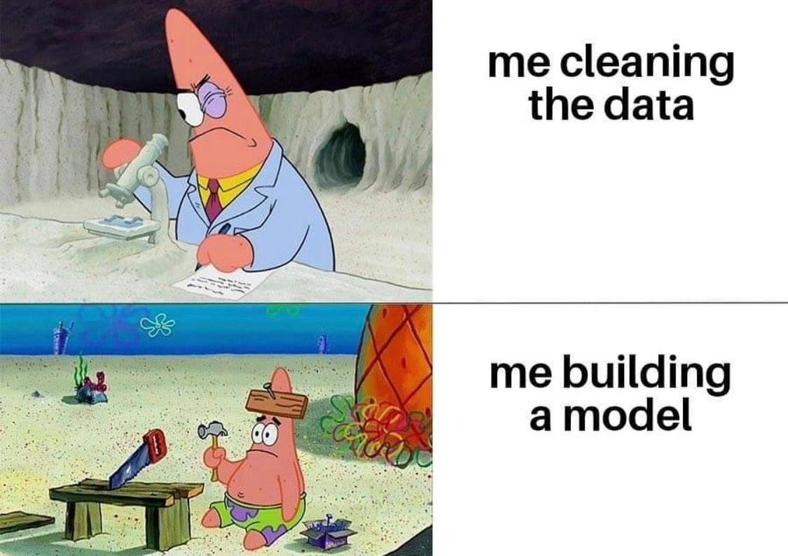

# Journal — 2025-10-04 — Day 4: Learning Data Quality (DQ) and Practical Next Steps

---

## 1) What I learned (short bullets)

- Data quality matters because bad inputs amplify into bigger, faster mistakes downstream.
- Bad data costs time and trust: wasted analysis, wrong decisions, and dashboard shame.
- A DQ contract (rules, thresholds, and owners) helps teams decide what should warn vs what should fail.
- Logging checks over time (not just pass/fail) reveals trends and helps catch gradual drift.
- Presentations and dashboards serve different needs: narrative-led slides for decisions, persistent dashboards for operational monitoring.

---

## 2) New vocabulary (my quick definitions)

- Data Quality (DQ): How much I can trust a dataset to answer the question I care about — includes timeliness, completeness, and correctness.
- Freshness of the data: How late the newest data shows up compared to when it should be available.
- Maturity model (DQ): Stages that describe how advanced monitoring is, from manual checks to automated observability.

---

## 3) Data engineering mindset I used

- Trust is layered: accuracy without timeliness or completeness still breaks workflows.
- Version control matters for data too: commit history helps troubleshoot when things break.
- Be transparent: document checks, owners, and thresholds so others know what to rely on.

---

## 4) Decisions & trade-offs I made

- I decided to start with a minimal, practical approach: row counts, null checks, and category validation — because simple wins are better than perfect but invisible systems.
  - Alternative way: build sophisticated anomaly detection now — but that’s higher cost and slower to deliver.
  
---

## 5) Open questions I'm still thinking about

- Who should own DQ contracts in small teams — the analyst, the engineer, or a shared steward?
- How to know when it is already the good data?
- In a large scale of team, how should version control strategies scale across multiple teams?

---

## 6) Next actions (small, doable)

- Improve presentation skills for data findings.
- Implement three dbt tests: row count non-zero, required fields not_null, and category whitelist for a key column.
- Build a starter Metabase card/dashboard with row counts, null rates, and a simple trend line for a critical table.

---

## 7) Artifacts & links

- Our Group Documentation for OULAD w DQ: [ftw_de_bootcamp](https://github.com/shieryl-ryle/ftw-de-bootcamp/blob/OULAD-final/Documentations/OULAD%20Docs/Group2_Final_Project_Documentation.md)

---

### Mini reflection (3–5 sentences)

This session shifted how I think about data work: DQ is not a one-time cleanup but a continuous, instrumented practice. I appreciated that small, visible checks (row counts, nulls) restore stakeholder trust quickly. Above all, I learned that data quality is everything: no trust, no impact. Going forward I want to focus on making checks cheap to run and easy to interpret for non-technical teammates.

### Meme moment
What captures my DQ mood today? A Patrick star energy:  

