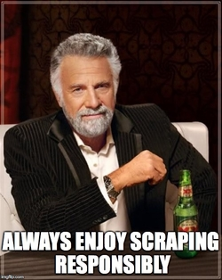

# 📓 Journal — October 11, 2025 (Week 5)
**Topic:** Web Scraping, API Integration, and Ethical Data Practices  

---

## 1️⃣ What I Learned  

- This week, I finally understood what happens *behind the web pages* we see every day — how data travels, loads, and transforms.  
- I learned that **web scraping** isn’t just about “getting data.” It’s a technical process that requires awareness of structure, permissions, and purpose.  
- Discovered the three levels of scraping: **static HTML**, **dynamic (JavaScript)**, and **protected sites** — each one more complex than the last.  
- **APIs** feel like a more respectful way to gather data — structured, efficient, and usually intended for public use.  
- I finally saw how **different data shapes** exist (tabular, hierarchical, time-series, geospatial), and how each affects how data is processed.  
- Realized that **Pandas** is like a reliable lab partner for small experiments, but not enough when data grows massive — that’s where **Ibis** or **SQL** come in.  
- Learned that **data ethics** isn’t a side topic — it’s what defines whether a project is truly responsible.  

---

## 2️⃣ New Vocabulary  

- **Web Scraping:** Automating the process of collecting visible data from websites.  
- **Headless Browser:** A browser that runs without an interface, perfect for scraping dynamic sites.  
- **API (Application Programming Interface):** A bridge that allows one system to request and receive structured data from another.  
- **Endpoint:** A specific API URL that provides a particular dataset or function.  
- **Pagination:** A method APIs use to deliver data in parts or “pages.”  
- **Rate Limiting:** A safety rule that limits how often you can request data.  
- **Data Lifecycle:** The full journey of data — from creation, processing, and storage to usage and retirement.  
- **Data Ethics:** The practice of collecting, using, and sharing data in a way that respects privacy, consent, and fairness.  

---

## 3️⃣ Data Engineering Mindset  

- **Integrity over convenience.** Just because data is accessible doesn’t mean it’s okay to use.  
- **Respect the flow.** Understanding how data moves is more powerful than memorizing code.  
- **Continuous learning.** Tools evolve, but principles like structure, logic, and ethics stay constant.  
- **Document what matters.** Logging data sources and steps builds trust and accountability.  
- **Curiosity with boundaries.** Be curious enough to explore, but aware enough to know where to stop.  

---

## 4️⃣ Decisions & Assumptions  

- I decided to focus on **APIs first**, since they’re cleaner and easier to handle ethically compared to scraping.  
- Used **Open Meteo API** to practice pulling weather data — it felt satisfying to see real-time results in JSON form.  
- For now, I’m working mainly with **CSV and JSON**, but I plan to explore **Parquet** to see the difference in performance.  
- I avoided scraping dynamic or protected sites because I realized it can easily cross ethical or legal lines.  
- I assumed that documenting sources and data flows early will help me when the capstone project begins.  

---

## 5️⃣ Open Questions  

- How do I confirm if a website’s data can legally be scraped?  
- What’s the best practice for logging API requests and failures for transparency?  
- How do data teams handle situations when APIs suddenly change their schema or structure?  
- When handling multiple data formats, what’s the best strategy to maintain consistency?  

---

## 6️⃣ Next Actions  

- [ ] Fetch real-time data from an open API and convert it to a Pandas DataFrame.  
- [ ] Try saving the same dataset in CSV, JSON, and Parquet, then compare file sizes.  
- [ ] Add a simple log file to track API request time and success rate.  
- [ ] Read more about responsible scraping and data privacy guidelines.  

---

## 7️⃣ Artifacts & Links  

- [BeautifulSoup Documentation](https://beautiful-soup-4.readthedocs.io/en/latest/)  
- [Playwright for Python](https://playwright.dev/python/)  
- [Open Meteo API](https://open-meteo.com/)  
- [Ibis Project](https://ibis-project.org/)  
- [DuckDB](https://duckdb.org/)  

---

## 8️⃣ Mini Reflection  

This week made me realize how powerful — and sensitive — data work can be. At first, I thought web scraping was just a clever way to get information, but now I understand the layers of responsibility that come with it. There’s a fine line between curiosity and intrusion, and I don’t want to cross it.  

I liked seeing how technical skills and ethics intersect — that being a good data engineer isn’t only about code but also about conscience. Every dataset I touch represents real people, systems, or events, so how I treat that data matters.  

> “In data engineering, power comes with responsibility — the power to collect, but also the responsibility to respect.”  

That line sums up how I feel after this week. I want to be the kind of data engineer who builds things that are not just efficient, but also kind and transparent.  

---

### BONUS: Interactive Meme Moment
What meme fits your SQL journey today?

